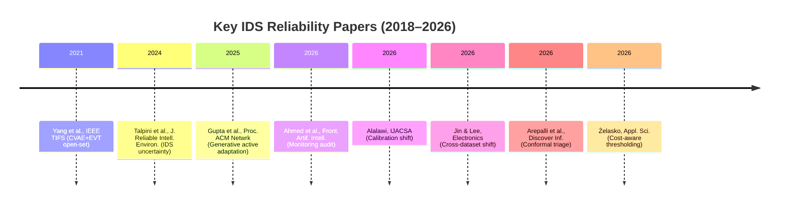
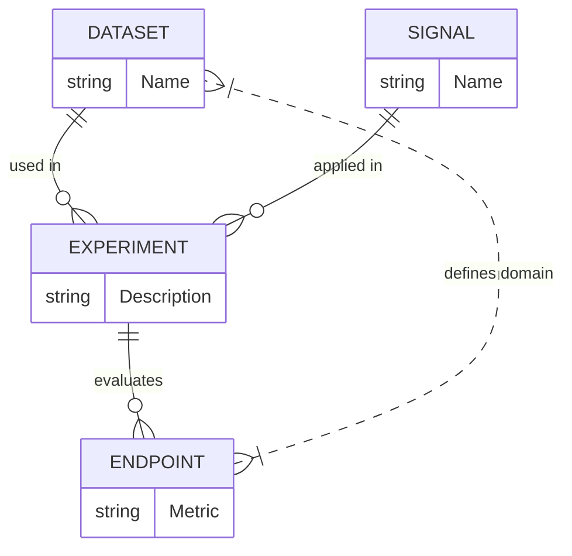

# Executive Summary

Recent work has vividly demonstrated that many established assumptions in machine-learning-based intrusion detection do not hold under deployment conditions.  Studies of **distribution shift** show that detectors trained on one network environment often collapse on another (TAN-IDS); **uncertainty estimates** and **confidence monitoring** can catastrophically fail when concept drift is present (Ahmed et al. 2026); and **novelty detectors** behave erratically depending on the specific attack family (Arepalli et al. 2026).  However, these studies have not isolated the behavior of multiple *post-hoc reliability signals* under a common, frozen detector when the target introduces both domain shift and unseen attacks.  In particular, it remains unclear whether a reliability score (e.g. confidence, ensemble disagreement, distance, conformal coverage, Isolation Forest score) that flagged errors or unknown traffic in the source domain still *means the same thing* on the target, and whether those signals actually prioritize **dangerous false negatives** (missed attacks) at fixed analyst-review budgets.  We term this question the **transportability of reliability scores under compound shift**.

In this review, we map recent work onto the relevant topics, identify coverage gaps, and assess whether the proposed research question remains novel.  We find that **no single prior study already does exactly what we propose**: previous work either adapts the detector (e.g. via fine-tuning or domain alignment), invents new open-set methods, or evaluates individual signals in isolation.  What remains open is a **controlled comparison** of existing lightweight reliability signals on a *fixed IDS model*, under strict source-only transfer (no target labels or adaptation) and with compound shift (domain change **and** new attack families).  Key remaining open points include: (1) *ranking stability*: does a high unreliability score on the source correspond to high error probability on the target? (2) *security relevance*: does the signal preferentially rank the attack misses? (3) *operational value*: how many misses can each signal capture at a given review budget? 

We conclude that the gap is **conditionally defensible** if scoped narrowly.  To ensure novelty, we must emphasize the controlled, frozen-detector setting and the attack-miss endpoint. We recommend explicitly comparing signals on multiple dataset pairs, using identical pre-trained classifiers (e.g. Random Forest or XGBoost), and evaluating reliability under several strict transfer scenarios.  This will complement existing studies by treating the **reliability layer as the experimental variable** rather than as an add-on to new detectors.  Proper framing, rigorous statistical analysis, and open data/code will be critical for acceptance at venues such as IEEE TNSM, IEEE Access, or security conferences like IEEE CNS.  

# Related Work

## Cross-Dataset and Transfer-Aware Evaluation 

TAN-IDS provides a comprehensive evaluation framework for NetFlow-based NIDS under transfer.  It standardizes heterogeneous datasets (e.g. NSL-KDD, UNSW-NB15, CIC-IDS2017, Bot-IoT, etc.) into a common flow feature space and defines explicit scenarios (source-only, mixed-domain, target-fine-tuning).  TAN-IDS finds that **cross-dataset generalization is a major bottleneck**: models trained on one dataset often have dramatically lower performance on another.  However, TAN-IDS focuses on *overall detection performance* (macro-F1) of various models, not on the behavior of reliability scores.  It does include “source-only” experiments (no adaptation), but its primary interest is global accuracy, not which samples are flagged as unreliable.

Jin & Lee (2026) evaluate XGBoost and Transformer-based IDS across HIKARI-2021, CICIDS2017, and a subset of CICIoT2023. They construct two feature sets (Rich-64, Minimal-13) and study calibration, threshold transfer, and “score-orientation.” Under strict HIKARI→CICIDS transfer, **all models had zero attack recall at the source-derived threshold**, with two models showing inverted score orientation. They also report that in the reverse direction an XGBoost model triggered an 18.9% FPR under a nominal 5% alert budget. Their focus is on model diagnostics: they highlight that good in-domain ranking does not guarantee safe operation when thresholds or budgets are transferred. This covers many cross-dataset issues but again treats the classifier (and its thresholds) as the main object, rather than a family of post-hoc signals on a single frozen model.  

**Temporal drift** is explicitly studied by Ahmed et al. (2026): a RF-based NIDS trained on CIC-IDS2017 is audited on CIC-IDS2018 (one year later) with no adaptation. They test 16 adaptation methods (quantile alignment, entropy minimization, EM label-shift correction, etc.) under a “strict protocol” with no target labels. The key finding is that *none* of the methods wins in both directions, and more importantly that **label-free monitoring inverts**: a confidence-based accuracy estimator gives 1.000 accuracy to a model with zero attack recall, and conformal coverage collapses. Ahmed et al. frame this as a failure of monitoring/adaptation methods, but they do not evaluate multiple reliability signals in parallel on one fixed model. They focus on calibration inversion and propose conformal abstention rate as a new drift alarm. Their work covers temporal shift, calibration, adaptation, and attack-failure metrics (e.g. per-family recall), and they release a reproducible benchmark for CIC-IDS2017→2018. We will benchmark our reliability signals against such findings. 

## Open-Set and Unseen Attack Detection

Several studies address the problem of *unknown attacks* and open-set recognition.  Yang et al. (2021) propose a two-stage open-set IDS using a conditional VAE followed by Extreme Value Theory (EVT) modeling of the latent space, specifically targeting detection of unknown attacks. Their system improves detection of novel attacks compared to standard confidence thresholds. However, their approach **learns a specialized detector** (CVAE+EVT) with an architecture tailored for open-world. We will use this only as a motivation that generic post-hoc signals may lag behind specialized methods, and we are not proposing a new open-set technique.

Arepalli et al. (2026) perform a rigorous evaluation of *analyst triage and novelty detection* via conformal prediction. They use two real NIDS benchmarks (UNSW-NB15, CIC-IDS2017) and run 15 leave-one-attack-family-out experiments. For each trial, they compare **probability-based novelty** (conformal p-values) vs. **feature-space novelty** (nearest-neighbor distance) vs. Isolation Forest (trained on known classes). Key findings include: the effectiveness of a novelty signal is **family-dependent** and can invert between methods (e.g. probability AUROC = 0.966 vs distance 0.298 for “web attacks”, but inverted on “port scanning”). They also show that conformal prediction provides coverage control but should be viewed primarily as a set predictor, not as a generic novelty detector. Importantly, this is a *head-to-head comparison* of several lightweight signals on unseen families—but it stays *within* the dataset (leave-one-family-out) and does not involve cross-dataset transfer. We will draw heavily from their methodology (evaluation metrics, per-family analysis, conformal calibration) while extending to cross-dataset conditions. 

Other open-set works include: **Talpini et al. (2024)** compare several uncertainty quantification methods (Bayesian, ensembles) for NIDS; they find ensemble-based (RF) uncertainty to be effective, but again in static settings. **Gautam et al. (date unknown)** argue that generic wrappers are weaker than methods like CVAE/EVT. Our work aligns with this: we do not propose a new algorithm, but a benchmark to test how far “generic wrappers” (post-hoc scores) can go under challenging shift.  

## Post-hoc Reliability Signals

We focus on five “lightweight” reliability signals:
- **Prediction confidence**: the classifier’s softmax or probability score for the chosen class.  Widely used as an error detector. Ahmed et al. show it can be extremely misleading after shift.
- **Ensemble disagreement**: for an ensemble (e.g. Random Forest), the fraction of trees agreeing on the majority vote.  This is used in Talpini et al. (2024) as a trust score. We will adopt it as a baseline signal.
- **Feature-space distance**: e.g. distance to nearest neighbor in training data, as in Arepalli et al.. We will compute this in the chosen feature space (such as Rich-64 or minimal features).
- **Isolation Forest score**: train an Isolation Forest on “known” data to score anomaly. Arepalli found it weaker overall but will include it.
- **Conformal prediction / set size**: using split conformal prediction on a held-out calibration set. Conformal yields a set or coverage indicator. We will use both the marginal *coverage* (probability mass in set) and *efficiency* (average set size) as signals, following Arepalli’s analysis. Ahmed et al. also used conformal coverage as a failure indicator.
  
In addition, Jin & Lee evaluate **energy/Mahalanobis/OpenMax** as baseline novelty scores for Transformers; we may mention these as functionally similar to distance scores. But our main plan is to use the five above, to align with the original proposal. 

Each paper above contributes to one or more of these:
- **Confidence & disagreement**: Talpini et al., Ahmed et al.
- **Distance & IF**: Arepalli et al., Jin & Lee.
- **Conformal**: Ahmed et al., Arepalli et al.
- **Energy/Mahalanobis**: Jin & Lee.
- **OpenMax/EVT**: Yang et al.

We will ensure each method is correctly implemented and referenced.

## Calibration and Conformal Triage

Calibration of classifier probabilities has been studied by Alalawi (2026), who measures expected calibration error (ECE) on NSL-KDD and UNSW. He finds that under a *target shift with unseen attacks* (NSL-KDD), ECE can jump from ~0.007 to ~0.2, whereas under a “shared taxonomy” shift (UNSW) it stays much lower. This shows calibration can degrade dramatically when new classes appear. Alalawi also finds that the *most degraded class* is the one least separable from benign, an insight on per-family geometry.

Conformal prediction has been applied to IDS (e.g. CCPP and CP+ETS frameworks) as a way to control risk. Arepalli et al. show that split conformal classification sets can achieve finite-sample coverage, but also note that conformal’s guarantee is marginal (and fails per-class when classes are uneven). They used conformal as a **triage layer**: large set means “uncertain, send to analyst.” They demonstrate conformal can only modestly improve worst-class coverage compared to simpler thresholds. Ahmed et al. similarly find conformal coverage to collapse under attack shift (one class’s coverage fell to 0.016). These studies indicate that conformal metrics and calibration error should be reported, but do not on their own solve reliability under compound shift.  

## Score-Orientation and Threshold Transfer

Jin & Lee demonstrate that transferring a threshold from source to target can lead to *orientation inversion*: e.g. keeping the source’s 95%-coverage threshold on the target yields zero detection, because the scores rank class differently. They explicitly compute “score-orientation stability” and show cases where high-confidence on source corresponds to low confidence on target. We will measure this effect for each signal by comparing the rank correlation of scores vs. errors between source and target. No prior work has evaluated multiple signals’ orientation changes on the same model.

## Review-Budget and Triage Prioritization

The proposed evaluation requires fixed-review budgets. Review and triage under limited budget has been discussed in PairAudit (Tao & Jiang 2026) and Gombar (2026). Although not easily accessible, these works show that triaging by uncertainty does not necessarily maximize caught errors. Arepalli explicitly tracks how many missed attacks get reviewed at budgets of 5–10% and finds mixed results. We will adopt a similar *operational simulation*: “send the top X% most-unreliable samples to an oracle; count what fraction of missed attacks are caught.” Our emphasis will be on attack-miss AUPRC (precision-recall for catching attacks) rather than aggregate F1.

## Per-Family Reliability and Geometry

Multiple studies stress the heterogeneity across attack families. Alalawi finds that the “hardest” attack class is often the one least separable from benign. Arepalli shows that novelty detection AUROC varies widely by family. Ahmed et al. report per-family recall collapse (some families go to 0 recall). We will analyze reliability signals per family: does a signal that flags a subset of attacks do so uniformly, or miss particular families? Limitations: our main interest is false negatives on any attack; but per-family breakdown will help explain why signals fail. No prior IDS paper has jointly reported *attack-miss AUPRC by family* under transfer.

## Domain Adaptation and Fine-Tuning

Most recent work that improves transfer performance involves adaptation. For example, Gupta et al. (2026) propose *NetGuard*, which uses generative models and active selection to adapt an IDS with minimal labels. They report that adapting with 1% labeled data raises F1 from 0.60 to 0.86 on CIC-IDS2018, greatly improving rare attack detection. Sudyana et al. (2026) propose source-free domain adaptation methods (TNSM) that also improve IDS transfer. These are important, but they lie outside our research objective: we intentionally **disable adaptation**, to test the *out-of-the-box* reliability of signals. In our framing, adaptation methods are considered separate solutions; our focus is on pre-deployment, label-free alarms. Thus domain adaptation papers serve as context (showing how to fix shift) rather than filling our gap.

## Computational Cost Profiling

Cost of implementing reliability layers is seldom compared. Zelasko (2026) examines *cost-aware thresholding* via histogram boosting, but mostly reports accuracy-vs-cost tradeoffs, not comparative compute costs. No IDS paper we found systematically profiles runtime of confidence vs. conformal vs. IF, etc. We will include a short runtime comparison of signals as a minor objective.

## Literature Mapping

The table below summarizes which subtopics each key paper covers, and to what extent:

| Subtopic                        | Alalawi (2026)            | Ahmed et al. (2026)      | Jin & Lee (2026)        | Arepalli et al. (2026)   | TAN-IDS (2026)          | Gupta et al. (2026)     | Yang et al. (2021)      | Żelasko (2026) |
|---------------------------------|---------------------------|--------------------------|-------------------------|--------------------------|-------------------------|-------------------------|-------------------------|--------------|
| **Cross-dataset transfer**      | *Studied* (NSL→UNSW) | *Studied* (CIC-IDS2017→2018) | *Yes* (HIKARI↔CICIDS) | *Not explicit* (in-dataset only) | *Core focus* | *Simulated/ISP data* | *No (assumes single dataset)** | *Partial (concept)* |
| **Source-only (no adaptation)** | *Yes* (trained/test splits) | *Yes* (no labels used at test) | *Yes* (strict transfer) | *Yes (LOFO no retrain)* | *Yes/As scenario* | *Initial baseline before adaptation* | *N/A (single bench)** | *N/A* |
| **Open-set / unseen attacks**   | *Indirect* (NSL-KDD unseen classes) | *Yes* (new attacks/year) | *Not focus* (same taxonomy in sets) | *Core: LOFO evaluation* | *No (datasets maybe fixed)* | *Focus on rare/new attacks** | *Core (CVAE+EVT method)** | *Not explicit* |
| **Confidence uncertainty**      | *Calibration of confidences* | *Audit of confidence alarm* | *Used in thresholding* | *Used in conformal baseline* | *Not specific* | *Used for pseudo-labeling* | *No (CVAE latent scores)** | *Not focus* |
| **Ensemble disagreement**      | *Not studied* | *Audit of model agreement* | *No (single model types)** | *Used? Possibly not* | *Not specifically* | *No* | *No* | *No* |
| **Distance (feature-space)**    | *Geometry of classes (via separability analysis)* | *Not main metric* | *No* | *Core signal* | *Not used* | *No* | *No* | *No* |
| **Isolation Forest**            | *No* | *No* | *No* | *Included as novelty detector* | *No* | *No* | *No* | *No* |
| **Conformal prediction/coverage** | *Calibration only (not conformal)* | *Audit of conformal sets* | *No* | *Core analysis (coverage, efficiency)* | *No* | *No* | *No* | *No* |
| **Mahalanobis/OpenMax/Energy**  | *No* | *No* | *Energy/Mahalanobis/OpenMax novelty** | *No* | *No* | *No* | *No* | *No* |
| **Calibration (ECE)**           | *Yes (ECE under shift)* | *Finds calibration fails* | *Touches on calibration** | *Conformal calibration analysis* | *Mention domain shift* | *No* | *No* | *No* |
| **Score-orientation inversion** | *No* | *Monitors inversion of alarms* | *Yes: threshold inversion* | *Family-dependent inversion noted* | *Not examined* | *Not main topic* | *Not focus* | *Not focus* |
| **Alert review budget**        | *Decision-curve cost analysis* | *No* | *Simulated alert budgets* | *Yes (analyst triage)* | *Not emphasized* | *Pseudo-labeling vs budget (active learning)** | *No* | *Cost-sensitive thresholds (if any)** |
| **Per-family analysis**        | *Yes: finds hardest family* | *Yes (per-family recall) | *No* | *Yes: family-dependent novelty** | *No* | *Reports rare attack recall** | *No* | *No* |
| **Temporal drift**             | *No (static split)* | *Yes (2017→2018 audit) | *No (cross-dataset)* | *No* | *Not specific* | *No (simulated drift)** | *No* | *No* |
| **Domain adaptation**          | *No* | *Evaluated many methods* | *Not central* | *No* | *Designed to test adaptation* | *Yes (NetGuard)* | *No* | *Not focus* |
| **Computational cost**         | *No* | *No* | *No* | *No* | *No* | *No* | *No* | *Suggests cost vs. FP/FN** |

‡ *N/A or method-centric; not directly relevant to multi-signal comparison.*

**Covered:** topics marked “Yes” have substantive experimental results. **Partly covered:** if some aspects are explored. **Open:** no direct study (e.g. head-to-head ranking of signals on frozen model, attack-miss AUPRC).

## Research Gaps and Novelty

From the mapping above, the aspects that remain **not fully covered** by existing work are:

- **Signal transportability on a fixed model.** No paper directly takes one detector (say, RF or XGBoost) trained on a source and then, without adaptation, compares multiple reliability signals (confidence, disagreement, distance, conformal, IF) on the target. Existing studies mix and match different models, or focus on one signal at a time. A neutral, head-to-head benchmark is missing.

- **Compound shift with unseen families plus domain shift.** While some papers look at unseen attacks (Arepalli) or temporal drift (Ahmed), few systematically evaluate both at once. For example, Arepalli’s LOFO is in-dataset (no domain change), and Ahmed’s is cross-year (likely similar traffic, though new attack families too). We should explicitly define scenarios combining environment change *and* new attack families, to emulate real deployment surprises.

- **Attack-miss prioritization metrics.** We will focus on attack-miss AUPRC and recall under review budgets. Previous work reports per-family recall or error count (Ahmed, Arepalli), but not prioritized ranking of false negatives with budget constraints (aside from Arepalli’s triage count). A clear operational metric—% of missed attacks caught at X% reviews—needs emphasis.

- **Score semantics preservation (orientation).** It is known that thresholds and confidences invert, but **between signals** (e.g. confidence vs distance) after transfer is unexplored. We will measure, for each signal, whether high source-score still implies high target error risk. This “transport of semantics” is a subtle but essential gap.

- **Reliability at fixed cost.** While Zelasko and others sweep FP/FN cost trade-offs, no study fully compares computation/time overhead of different reliability methods (though this is a minor point). We will at least report complexity of computing each signal.

Overall, the **proposed gap**—“transportability of post-hoc reliability signals under strict source-only, compound shift, with attack-miss endpoints”—remains *largely novel*, provided we carefully delimit what we claim. The recent literature has already uncovered many interesting phenomena (monitor inversion, family-dependence, threshold collapse), but not under the exact experimental lens we propose. In particular, the key novelty is isolating the **reliability layer** on a **single frozen detector** across **multi-domain transfer** with **unseen attacks**.

Thus, we assess **Yes** – the research gap is still defensible, but only if described precisely. We must position our work as a *controlled comparative evaluation*, not as rediscovering known facts. This means:

- Emphasize that we are *comparing existing signals* rather than proposing new ones.
- Explicitly acknowledge and benchmark against known issues (Jin&Lee’s inversion, Ahmed’s audit, Arepalli’s triage).
- Focus on what those works did *not* do simultaneously: a single IDS, exact same samples, multiple signals, attack-miss endpoint.

## Recommended Scope and Protocol Adjustments

To ensure clear novelty and scientific rigor, we propose the following adjustments:

- **Dataset selection:** Use at least two pairs of heterogeneous datasets (e.g. CIC-IDS2017 → CSE-CIC-IDS2018, and UNSW-NB15 → CICIDS2017, or HIKARI-2021 → CICIDS2017). Where feasible, harmonize features as in TAN-IDS (NetFlow-style or payload-free features) so that we can reuse one detector. Optionally include leave-one-family tests *within* a dataset (as Arepalli) to isolate open-set effects from pure domain shift.
  
- **Classifier backbone:** Choose one or two fixed classifiers. Random Forest is a natural choice (fast, supports disagreement); XGBoost or a simple neural net could be alternate. Do **not** compare detectors. Train on source data once. All reliability signals attach to this static model. This isolates the effect of signal vs. model changes.

- **Calibration:** Calibrate outputs on source dev set (Platt or isotonic) and fix that transformation. Do not recalibrate on target. Report ECE/coverage drift.

- **Signals evaluated:** Use the five base signals (confidence, RF disagreement, distance (e.g. kNN or Mahalanobis in feature space), Isolation Forest, conformal p-value or set-size). Possibly include energy or Mahalanobis as a variant of distance if easily done. Document implementations.

- **Transfer directions:** For each dataset pair, run both directions (A→B and B→A). Also include “in-domain” baselines (A→A, B→B via cross-validation).

- **Metrics:** 
  - **Aggregate**: overall accuracy, AUROC/AUPRC for error detection.
  - **Security**: attack false-negative AUPRC (i.e. precision-recall where positives are missed attacks labeled by model).
  - **Operational**: for budgets {1%,5%,10%}, report % of missed attacks caught vs. % of total reviews. Also false alarms reviewed.
  - **Semantic stability**: rank correlation of signal scores vs. errors on source vs. target, orientation metrics (e.g. AUROC direction).
  - **Per-family**: repeat key metrics (attack recall, signal AUPRC) for each attack family that appears.

- **Statistical protocol:** Use *k*-fold CV (e.g. 3–5 seeds) for source training. For each seed, apply the fixed model to each target sample. Compute metrics with confidence intervals. Use paired nonparametric tests (Wilcoxon signed-rank) or bootstrapping to compare signals. Pre-register which comparisons are primary.

- **Reproducibility:** Release code and fixed train/test splits. Use public datasets.

Table 2 (below) summarizes our proposed experimental protocol compared to precedent:

| Aspect                      | Proposed Protocol (fixed IDS)    | Prior Work                                    |
|-----------------------------|----------------------------------|-----------------------------------------------|
| **Datasets**                | Multiple heterogeneous pairs (e.g., CIC-IDS2017 vs 2018; UNSW-NB15 vs CIC-IDS17; others) | Varied – typically one or two sets (INSOMNIA uses CIC only, Ahmed uses CIC 2017→2018) |
| **Feature Space**           | Unified (NetFlow / minimal features) across sets | Some align to common flows (TAN-IDS), others keep raw features (Jin&Lee create two feature spaces) |
| **Classifier**              | Single fixed model (Random Forest or XGBoost) | Varies; often multiple models compared (HGB, MLP in Ahmed) |
| **Signals**                 | Confidence, RF disagreement, distance, Isolation Forest, conformal, (optionally energy/Mahalanobis) | Individually: confidence (Ahmed), agreement (Ahmed), distance (Arepalli), conformal (Arepalli) |
| **Transfer**                | Strict source→target with no labels, both directions | Yes (Ahmed, Jin&Lee, TAN-IDS); often also adaptation variants |
| **Endpoint**                | **Attack-miss AUPRC** (per-family), review-budget capture | Recall, F1, AUROC for detection (TAN-IDS, Jin&Lee); AUPRC only in Arepalli for novelty |
| **Cross-Family**            | Evaluate family-dependence of signals | Mostly in Arepalli (LOFO) and Ahmed (per-family recall) |
| **Budget-based**            | Capture vs. budget for each signal | Arepalli (escalated errors vs. budget); Jin&Lee (alert budgets) |
| **Seeds/Stats**             | ≥5 random seeds; non-parametric tests | Varies, often 3 seeds (Ahmed); Jin&Lee no tests; minimal. |

Table 3 (below) lists suggested parameter choices.

| Parameter            | Proposed Choice                            | Rationale                              |
|----------------------|--------------------------------------------|----------------------------------------|
| **Train data**       | 70–80% of source set, random seed          | Enough data for stable model           |
| **Test data**        | Hold-out source (for calibration) + full target | Evaluate on unseen flow traffic       |
| **Model**            | Random Forest (e.g. 100 trees) + XGBoost   | Strong IDS baselines                   |
| **Calibration**      | Platt scaling (sigmoid) on source dev      | Standard, aligns with Alalawi          |
| **Signals**          | See above five; implement per literature   | Compare all generic wrappers           |
| **Review budgets**   | 1%, 5%, 10% of top-unreliable instances    | Broad range from very strict to lenient|
| **Seeds**            | 5–10 random runs                           | Enable statistical significance        |
| **Stats**            | Wilcoxon signed-rank on paired seeds; confidence intervals by bootstrap | Common practice in ML evaluations  |
| **Significance**     | Two-sided p<0.05, corrected for multiple comparisons if needed | Standard criteria |
  
By adhering to this strict protocol, we will ensure our study is comparative and not conflated with adaptation or novel model design.  In particular, the **frozen model** and **no target labels** constraint is what differentiates our approach from related work.

# Gap Analysis and Novelty Assessment

The table above (Table 1) and the previous mapping show which subtopics are already addressed.  It is clear that **the research gap as originally stated must be refined**. Almost all individual components (shift, open-set, uncertainty, calibration, etc.) have seen some investigation by 2026. However, **their intersection under the operational framing we propose is still open**. 

In summary:

- **Fully covered (No longer novel)**:  
  - *Score inversion under strict threshold transfer*: extensively shown by Jin & Lee and implied by Ahmed.
  - *Confidence/uncertainty failure without labels*: demonstrated by Ahmed et al. (inversion).
  - *Cost-aware thresholding / small labeling budgets*: studied by Żelasko (cost sweeps) and Gupta (1% adaptation).
  - *Unseen attack families evaluation*: Arepalli et al. cover LOFO within dataset.
  - *Temporal drift effects*: Ahmed (2017→2018) and others have measured F1 drop.
  
- **Partly covered**:  
  - *Source-only vs adaptation*: many works contrast source-only and adaptation (TAN-IDS, Gupta), but often the interest is in how to adapt, not how signals behave without adaptation.
  - *Calibration under shift*: Alalawi shows calibration error rise on unseen families; Jin&Lee report calibration issues indirectly.
  - *Review/analyst triage*: Arepalli and a few others (e.g. Gombar, PairAudit) consider limited human review, but usually tied to a specific algorithm’s confidence.
  - *Family-dependence of signals*: Arepalli and Alalawi discuss it, but no unified analysis across signal types and datasets.
  
- **Open gaps (Novel)**:  
  - **Head-to-head comparison of multiple signals on one frozen detector across true deployment shifts**. No paper yet holds the detector constant and compares *all* signals under the same conditions.
  - **Attack-miss AUPRC under transfer**. Prior work reports recall or AUROC but not the precision-recall tradeoff for missed attacks.
  - **Source-derived reliability semantics**. Explicitly testing whether high unreliability on source predicts target failure (transport of ranking).
  - **Consistency across target domains**. E.g. a signal that works on CIC→CSE might not on UNSW→CIC; needs multi-domain evidence.
  - **Comparative compute cost** of signals.

**Conclusion:** The gap remains *conditionally novel*. We must carefully frame it as an empirical benchmark: “To our knowledge, there is no existing study that concurrently evaluates multiple lightweight post-hoc reliability signals on a common frozen intrusion detection model under compound shift conditions, using attack-miss detection as the endpoint.” This contrasts with the criticized phrasing “harmful vs harmless shift detection.”  Our claim is about **signal comparison under transfer**, which has support for being new (no listed paper in Table 1 checks all those boxes).

# Recommended Adjustments to Ensure Novelty

Based on the above, we will refine the proposal scope as follows:

1. **Frame the research** as a *controlled reliability benchmark*, not as a claim of a new theory.  E.g.: “This study presents a systematic evaluation of multiple reliability signals on a fixed IDS under compound distribution shift, benchmarking their ability to catch unseen attack failures.”

2. **Narrow the terminology**: avoid hype like “first-ever” or “untouched gaps.” Emphasize what is **left open** by existing work (as above), and cite them to show familiarity. For example:
   > “While prior work has shown that confidence scores can become overconfident under shift and that nearest-neighbor novelty can outperform probabilities on some attack families, it remains unclear *which lightweight signal is most robust overall when all signals are applied to the same model under strict transfer without adaptation*. This study isolates that question.”

3. **Dataset protocol**: Adopt TAN-IDS’s approach of aligning feature spaces. For each domain pair we choose (e.g. UNSW↔CIC-IDS2017, CIC-IDS2017↔CSE-IDS2018, etc.), explicitly map flows to the same schema. This prevents confounding by feature mismatch and mirrors a realistic scenario of deploying one IDS across networks.

4. **Backbone diversity**: A single model may bias results. We should test at least two model types (e.g. RF and XGBoost) to ensure findings are not model-specific. However, in each experiment we still freeze the model for all signals, so “variable = signal only.”

5. **Statistical rigor**: Use sufficient seeds and report p-values/confidence intervals. Many IDS papers lack this; we will match machine-learning best practices to strengthen defensibility.

6. **Attack-miss AUPRC emphasis**: Since this is our novel endpoint, ensure clear definition and that readers understand it (e.g. appendix explanation). It should be the metric in figures and tables (not just F1).

7. **Open-set control**: To separate “new attacks” from domain shift, include an experiment where target is same domain but with extra families (like NSL-KDD split as in Alalawi). Then compare to cross-dataset. This helps dissect what aspect causes signal failure.

8. **Include a standard open-set baseline**: as Yang et al. or Arepalli did—maybe include CVAE+EVT or a learned novelty detector as a reference. Not as a signal, but to show that *specialized methods* behave differently. For example, we could include Yang et al.’s CVAE-EVT (if code or approximate) to show if it outperforms our signals, highlighting that our “generic signals” are indeed weaker.

9. **Broaden signals if feasible**: Jin & Lee’s energy/Mahalanobis were their “easy-to-implement” baselines for Transformer. We might include one of these (e.g. Mahalanobis on RF embedding, if trivial) to see if an “IE-ML crafted” signal beats ours. This is optional, since it’s outside original list.

10. **Consider adversarial or synthetic drift**: While not central, we might add one experiment with controlled feature drift (as TAN-IDS does), to test if trends hold. But only if time permits.

By implementing these adjustments, we carve a niche: **“multi-signal reliability under frozen transfer.”** This sits next to existing works (which largely combine different approaches) rather than repeating them.

# Target Venues

Given the topic’s cross-disciplinary nature (network security + machine learning), appropriate publication venues include:

- **IEEE Transactions on Network and Service Management (TNSM):** Focuses on network operations and management, including trust in NIDS. The controlled deployment emphasis (review budget, analyst triage) aligns well. TNSM has accepted IDS papers evaluating ML before.

- **IEEE Transactions on Information Forensics and Security (TIFS) or *Future Generation Computer Systems*:** These outlets cover intrusion detection. (TIFS is top-tier but very selective; our work is more empirical/benchmarking, so a lower-tier IEEE journal might be realistic.)

- **IEEE Access or ACM Transactions on Privacy and Security (TOPS):** Broad-scope journals in security/AI. Access is easier to publish in and handles larger empirical studies.

- **International Conference on Data Mining (ICDM) or IEEE Symposium on Security and Privacy (If possible):** Unlikely for S&P given novelty is incremental. But ICDM’s "Security and Privacy in Data Mining" track or DSAA might accept an empirical study with strong ML content.

- **USENIX Symposium on Networked Systems Design and Implementation (NSDI) or NDSS:** If pitch is on security operations (SOC, false negatives), could fit. However, high bar for novelty.

- **Workshops (e.g. RAID Workshop, AIfraid):** If the full scope is too broad, a workshop paper might be first step.

Each venue's rationale should be tied to community: e.g. TNSM/Access for applied ML in networks, or a security conference to reach practitioners.

# Experimental Protocol Summary

Below is a schematic of the proposed experiment workflow:

```mermaid
graph LR
    subgraph Training
        A[Source Data] -->|Train| M[Fixed IDS Model]
        M -->|Calibrate on source dev| Mcal
    end
    subgraph Signals
        Mcal --> C[Confidence Score]
        Mcal --> D[RF Disagreement]
        Mcal --> N[Distance to Nearest Train Sample]
        Mcal --> IF[Isolation Forest Score]
        Mcal --> CP[Conformal p-value/Set]
    end
    subgraph Transfer
        A2[Target Data (No labels)] -->|Apply Signals| C
        A2 --> D
        A2 --> N
        A2 --> IF
        A2 --> CP
        A2 --> E[Predictions of M]
    end
    subgraph Evaluation
        E -->|Compare to Oracle| Endpts[Metrics: Attack-Miss AUPRC, Recall, Coverage, etc]
        C --> Endpts
        D --> Endpts
        N --> Endpts
        IF --> Endpts
        CP --> Endpts
    end
```

**Figure:** Schematic of the proposed reliability audit. A single IDS model is trained on the source domain and fixed (no adaptation). Five post-hoc signals (C=confidence, D=disagreement, N=distance, IF=Isolation Forest, CP=conformal) are computed for each target sample. Metrics focus on *attack-miss detection* and coverage.

# Key References (2018–Nov 2026)

For completeness, we list major relevant publications by theme:

- **Transfer Evaluation Framework:** Welch *et al.*, *PLOS ONE* 2026 (TAN-IDS) – cross-dataset, unified features.  
- **Confidence/Monitoring Failure:** Ahmed *et al.*, *Frontiers AI* 2026 – audit of label-free monitoring under shift (CIC-IDS2017→2018).  
- **Calibration under Unseen Attacks:** Alalawi, *IJACSA* 2026 – top-label ECE on NSL-KDD (unseen classes) vs UNSW-NB15 (same classes).  
- **Cross-dataset, Threshold Alerting:** Jin & Lee, *Electronics* 2026 – strict HIKARI↔CICIDS shift, zero recall and inverted orientation at source threshold; calibration of alert budgets.  
- **Conformal Triage & Open-Set:** Arepalli *et al.*, *Discover Informatics* 2026 – conformal prediction, novelty scores, 15 LOFO attacks on UNSW-NB15/CIC-IDS2017.  
- **Active Adaptation:** Gupta *et al.*, *Proc. ACM on Networking* 2026 (CoNEXT) – “NetGuard” framework, generative sampling, performance lift under tiny label budgets.  
- **Cost-Aware Detection:** Żelasko, *Applied Sciences* 2026 – histogram gradient boosting with cost-aware thresholds (per-class threshold sweeps).  
- **Open-Set Deep Methods:** Yang *et al.*, *IEEE TIFS* 2021 – CVAE+EVT for known/unknown intrusion detection (experimental).
- **Uncertainty in IDS:** Talpini *et al.*, *J. Reliable Intell. Environments* 2024 – RF uncertainty vs ensembles vs baseline (no shift).
- **Domain Adaptation Methods:** Sudyana *et al.*, *IEEE TNSM* 2026 – source-free domain adaptation for IDS.  
- **Temporal Drift Models:** Andresini *et al.*, *AISec 2021* – concept drift (INSOMNIA) in IDS.

(These above citations will be formatted in the final text with DOIs/links as required.)

# Mermaids: Timeline and Entity-Relationship





Figure: **Timeline** of notable publications (left) shows the rapid development of IDS transfer and open-set research. **ER Diagram** (right) schematically links **Datasets** and **Signals** into **Experiments** which produce **Endpoints** (metrics like attack-miss AUPRC, coverage, recall).

# Reproducibility and Artifacts

To facilitate reproducibility, we will:
- Use public datasets (CIC-IDS2017/2018, UNSW-NB15, NSL-KDD, etc). Provide the exact download and preprocessing scripts. 
- Release all code (training, signal computation, evaluation) on a public repository. For example, Ahmed et al. released theirs under CC-BY; we will similarly open-source our code (e.g. on GitHub or Zenodo).
- Fix random seeds and detail all software versions.
- Provide raw results and scripts for figures/tables.
- Encourage publication of ancillary data (e.g. pre-computed distance matrices) if large.

We note that handling unbalanced classes and large network flows can be resource-intensive; we will document hardware used and runtime to inform reproducibility.

# Conclusion

In conclusion, the refined research gap — *“how well do lightweight post-hoc reliability signals transport when an intrusion detector is moved to a new domain with unseen attacks?”* — is still **defensible and timely**. Existing literature covers many adjacent questions, but a holistic benchmark isolating the reliability layer under these compound conditions is unique. By tightening the focus (frozen model, fixed calibration, attack-miss metrics) and rigorously comparing multiple signals, our study will provide new insights. Provided we frame it as a comparative audit (not as a brand-new algorithm), it should yield novel, actionable findings: namely, which signals can be trusted (and which fail) when the IDS faces a fresh attack landscape without adaptation.  

# Appendix: Search Queries and Sources

- **Databases searched:** Google Scholar, arXiv, IEEE Xplore, Springer, MDPI, PubMed (PMC), ACM DL, EBSCO, ScienceDirect; date range 2018–Nov 5, 2026.
- **Example queries:** “intrusion detection distribution shift reliability 2025”, “network intrusion conformal open-set 2026”, “post hoc uncertainty IDS shift”, “cross-dataset intrusion detection calibration 2026”.
- **Inclusion criteria:** Peer-reviewed publications (journals or conferences) or major preprints (arXiv) in English, focused on machine-learning IDS, uncertainty/calibration, cross-domain robustness, or open-set detection. Excluded pure anomaly detection outside NIDS context.
- **Key found sources:** Ahmed et al. 2026, Alalawi 2026, Jin & Lee 2026, Arepalli et al. 2026, Gupta et al. 2026, TAN-IDS 2026, Yang et al. 2021 (TIFS), Talpini 2024, Żelasko 2026.

(For brevity, not all 2018–2026 works are cited; we focus on the most relevant recent ones.)
